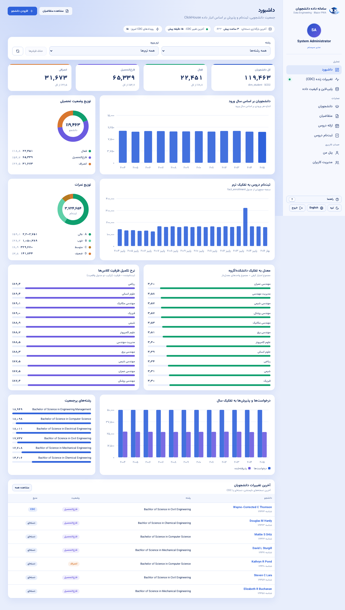
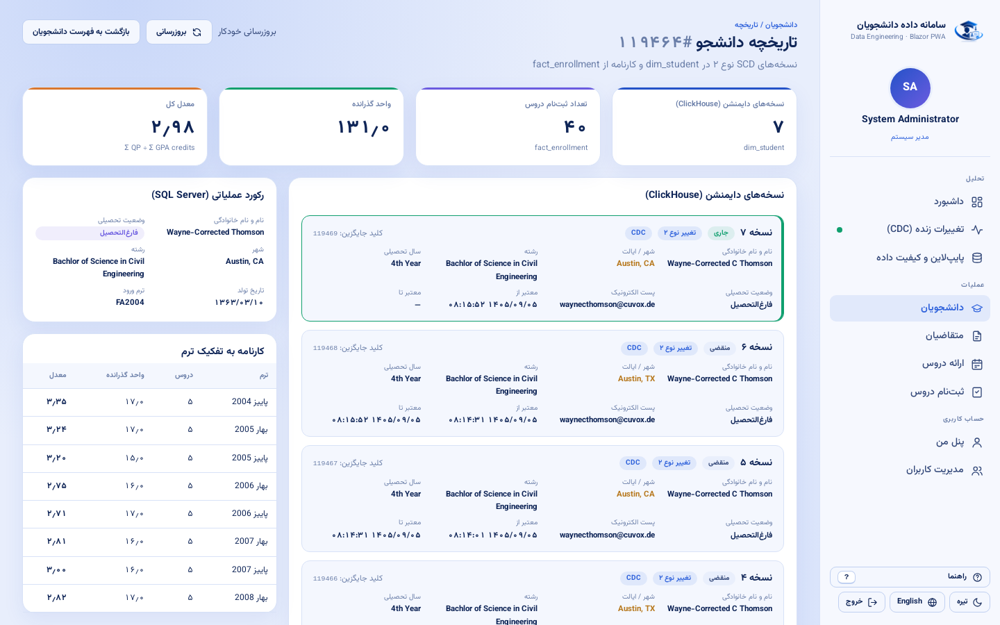
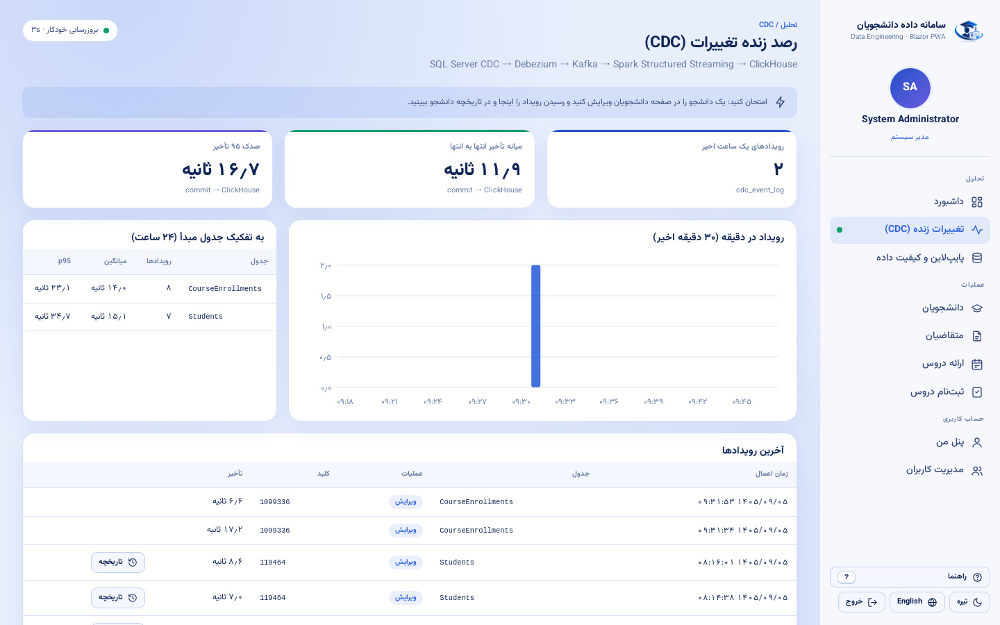
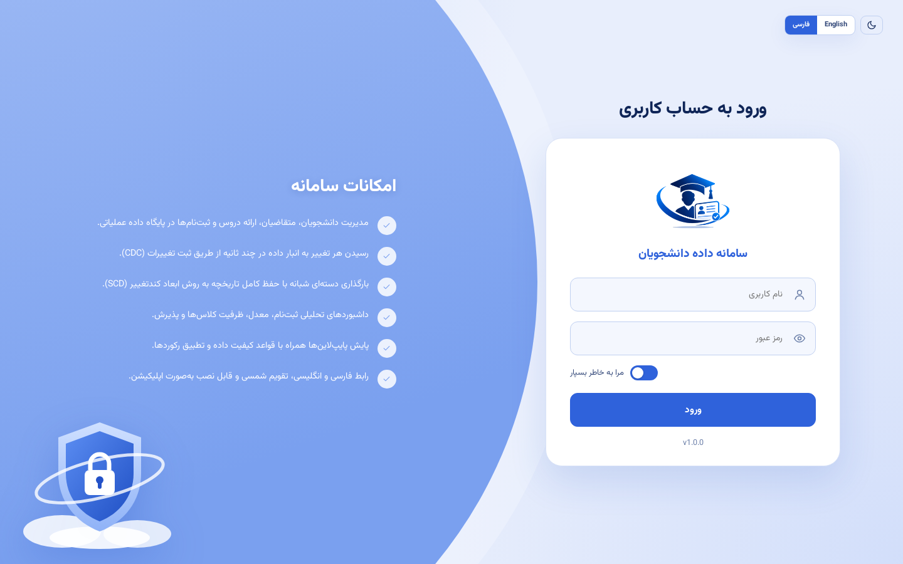
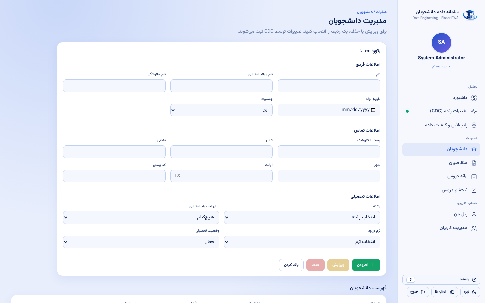
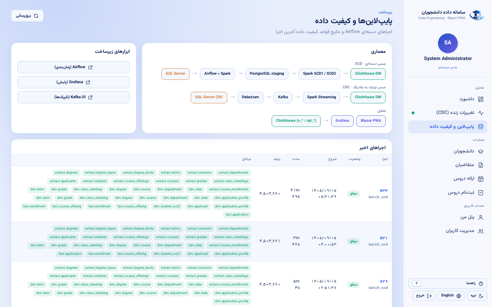
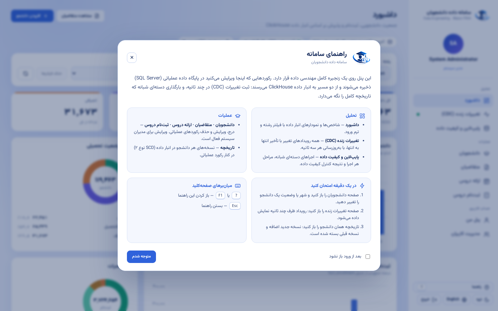
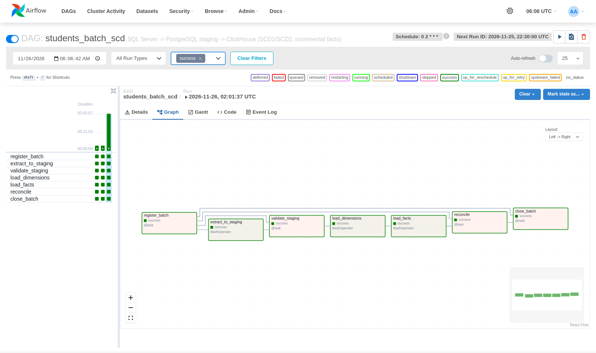
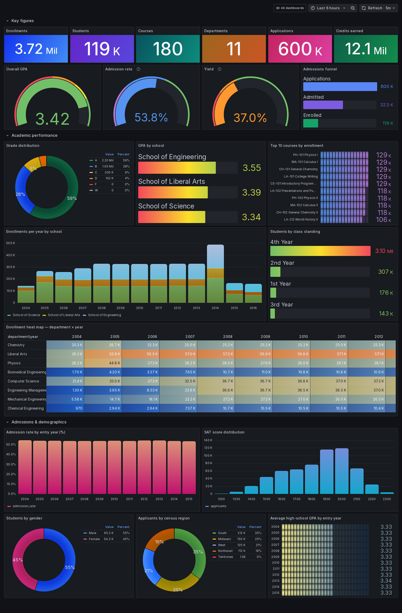
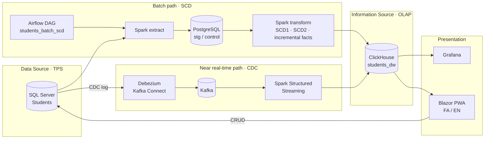

<p align="center"></p>

<div dir="rtl">

# Students Data Platform

[English](README.md) | **فارسی**

پلتفرم مهندسی داده برای پایگاه داده عملیاتی **Students**: از سیستم تراکنشی (TPS) روی SQL Server تا انبار داده تحلیلی روی ClickHouse، با **دو روش پیاده‌سازی لایه Transformation**:

| روش | مسیر | ویژگی |
|---|---|---|
| **Batch + SCD** | SQL Server → Airflow + Spark → PostgreSQL (Staging) → Spark → ClickHouse | بارگذاری دوره‌ای کامل، تشخیص تغییر با Hash، SCD نوع ۱ و ۲، بار افزایشی Factها |
| **Near Real-Time + CDC** | SQL Server CDC → Debezium → Kafka → Spark Structured Streaming → ClickHouse | انتقال تغییرات در حد چند ثانیه، همان منطق SCD2 روی رویدادهای CDC |

لایه نمایش شامل **Grafana** و یک **پنل دوزبانه (فارسی/انگلیسی) PWA با .NET 10 Blazor WebAssembly** است که هم روی SQL Server عملیات CRUD انجام می‌دهد (تولید تغییر برای CDC) و هم گزارش‌های تحلیلی را از ClickHouse نمایش می‌دهد.

<p align="center">
  
  
</p>
<p align="center">
  
  
</p>
<p align="center">
  
  
  
</p>
<p align="center">
  
  
</p>

تصاویر همه محیط‌ها (Airflow، Kafka UI، ClickHouse، Prometheus، همه داشبوردهای Grafana و پنل) در [README انگلیسی](README.md#screenshots) آمده است.

---

## معماری



| لایه | فناوری | نقش |
|---|---|---|
| Data Source (Relational / Operational) | SQL Server 2022 | پایگاه داده `Students` (بازیابی خودکار از `Students.bak`)، CDC روی ۴ جدول پرتغییر |
| Staging | PostgreSQL 16 | `stg.*` کپی خام هر Batch، `control.*` ثبت Batch و تولید کلید جایگزین |
| Orchestration | Apache Airflow 2.10 | DAG `students_batch_scd`: استخراج → کیفیت داده → Dimensionها → Factها → تطبیق |
| Processing | Apache Spark 3.5 | Batch (PySpark) و Structured Streaming با کتابخانه مشترک `studentsdw` |
| Streaming | Debezium 2.7 + Kafka 3.9 (KRaft) | انتقال تغییرات لاگ‌محور |
| DW / OLAP | ClickHouse 24.8 | مدل ابعادی Kimball، لایه معنایی `v_*` و `rpt_*` |
| Presentation | Grafana 11 · Blazor WASM (.NET 10) | داشبورد پایش و پنل دوزبانه PWA |

جزئیات طراحی، اصول Inmon و Kimball، و نحوه پیاده‌سازی SCD و CDC در [docs/ARCHITECTURE.md](docs/ARCHITECTURE.md) آمده است.

---

## اجرا با یک دستور

**پیش‌نیاز:** فقط Git و Docker. حداقل **۸ گیگابایت RAM** برای Docker و حدود ۱۵ گیگابایت فضای دیسک لازم است.

| محیط | Docker مورد نیاز |
|---|---|
| ویندوز | [Docker Desktop](https://www.docker.com/products/docker-desktop/) با WSL 2 backend (حالت Linux containers) |
| WSL | Docker Desktop با فعال بودن **Settings → Resources → WSL Integration** برای همان توزیع، یا Docker Engine نصب‌شده داخل WSL |
| لینوکس | Docker Engine با افزونه Compose v2 |

**۱. دریافت پروژه** (پایگاه داده `Students` به‌صورت فشرده داخل مخزن است و دانلود جداگانه‌ای لازم نیست):

```bash
git clone https://github.com/AliAbyari/students-data-platform.git
```

**۲. اجرا:**

- **ویندوز:** داخل پوشه `students-data-platform` روی `start.bat` دوبار کلیک کنید.
- **لینوکس یا WSL:**
  ```bash
  cd students-data-platform && ./start.sh
  ```

اسکریپت اجرا همه کارهای لازم را خودش انجام می‌دهد:
- بررسی Docker، و اگر Docker Desktop بسته باشد، اجرای خودکار آن
- انتخاب خودکار رجیستری: اگر Docker Hub در دسترس نباشد (خطای 403 در ایران) از mirror آروان استفاده می‌کند
- بازکردن فایل پشتیبان پایگاه داده و بررسی آزاد بودن پورت‌ها
- ساخت و اجرای همه سرویس‌ها و در پایان باز کردن پنل در مرورگر

اگر پروژه داخل فایل‌سیستم WSL باشد (مثل `\\wsl.localhost\Ubuntu\...`)، دوبار کلیک روی `start.bat` هم کار می‌کند و اجرا را به `start.sh` همان توزیع می‌سپارد. برای سرعت بیشتر در WSL، پروژه را داخل فایل‌سیستم لینوکس (مثل `~/`) clone کنید نه زیر `/mnt/c`.

اولین اجرا ۱۰ تا ۲۰ دقیقه طول می‌کشد: ساخت Imageها، بازیابی پایگاه داده، فعال‌سازی CDC و سپس بارگذاری اولیه انبار داده که Airflow آن را خودکار شروع می‌کند. اجراهای بعدی در کمتر از دو دقیقه بالا می‌آیند.

| سرویس | آدرس | نام کاربری / رمز (پیش‌فرض `.env`) |
|---|---|---|
| Students Portal (Blazor PWA) | http://localhost:9080 | `admin` / `Portal#Admin2026` |
| Airflow | http://localhost:8090 | `admin` / `Airflow#2026` |
| Grafana | http://localhost:3000 | `admin` / `Grafana#2026` |
| Kafka UI | http://localhost:8082 | — |
| Prometheus | http://localhost:9091 | — |
| ClickHouse HTTP | http://localhost:8123 | `dw` / `Dw_ClickHouse#2026` |
| SQL Server | `localhost,14330` | `sa` / `Sa_Students#2026` |
| PostgreSQL | `localhost:5433` | `platform` / `Platform#2026` |

برای توقف از `stop.bat` یا `./stop.sh` استفاده کنید. گزینه `--reset` همه Volumeها را پاک می‌کند تا اجرای بعدی از صفر شروع شود.

---

## سناریوی آزمون (برای ارزیابی)

1. **بارگذاری Batch:** در Airflow، DAG `students_batch_scd` را ببینید. پس از اتمام، صفحه «پایپ‌لاین و کیفیت داده» در پنل، مراحل اجرا و نتایج قواعد کیفیت داده را نشان می‌دهد.
2. **CDC زنده:** در پنل وارد صفحه «دانشجویان» شوید، یک دانشجو را انتخاب کنید و شهر یا وضعیت تحصیلی او را تغییر دهید.
3. **SCD نوع ۲:** روی «تاریخچه» همان دانشجو بزنید. ظرف چند ثانیه نسخه جدیدی در `dim_student` ایجاد می‌شود. نسخه قبلی با `valid_to` بسته می‌شود و فیلدهای تغییرکرده مشخص هستند.
4. **SCD نوع ۱:** نام دانشجو را اصلاح کنید. این تغییر روی همه نسخه‌های تاریخی اعمال می‌شود و نسخه جدیدی نمی‌سازد.
5. **Fact افزایشی:** در «ثبت‌نام دروس» برای همان دانشجو نمره ثبت کنید. معدل ترمی و کل در صفحه تاریخچه بروز می‌شود.
6. **پایش:** صفحه «تغییرات زنده (CDC)» و داشبورد *Students DW — CDC & Pipelines* در Grafana تعداد رویدادها و تأخیر انتها به انتها را نشان می‌دهند.
7. **پایش زیرساخت:** پوشه *Platform Monitoring* در Grafana را باز کنید. با `docker compose stop kafka` کاشی Kafka در داشبورد *Platform Health* ظرف چند ثانیه قرمز (DOWN) می‌شود و با `docker compose start kafka` دوباره سبز می‌شود.

### داشبوردهای Grafana

| پوشه | داشبورد | چه چیزی را نشان می‌دهد |
|---|---|---|
| Students Data Platform | Students DW — Overview | نمای کلی انبار داده (داشبورد خانه) |
| Students Data Platform | Students DW — CDC & Pipelines | رویدادهای CDC، تأخیر انتها به انتها، اجراهای Batch و کیفیت داده |
| Students Data Platform | Students DW — Insights | شاخص‌های رنگی: معدل، نرخ پذیرش، Yield، قیف پذیرش، توزیع نمرات، Heat map دپارتمان × سال |
| Students Data Platform | ClickHouse — Warehouse Internals | حجم و فشرده‌سازی جداول، Partها، کوئری‌های کند و خطاها (از جداول system) |
| Platform Monitoring | Platform Health — Service Status | UP/DOWN بودن Kafka، Connector دبزیوم، Spark و همه سرویس‌ها؛ وضعیت Containerها، Restartها و هشدارهای فعال |
| Platform Monitoring | System Load — Host & Containers | سنگینی سیستم: CPU، حافظه، دیسک، Load، PSI و مصرف منابع هر Container |
| Platform Monitoring | Kafka & CDC Streaming | Brokerها، Topicها، پیام بر ثانیه، Partitionها، Consumer lag و مسیر Debezium → Kafka → Spark |
| Platform Monitoring | Databases — ClickHouse, PostgreSQL, SQL Server | بار کوئری، حافظه، Partها، اتصال‌ها، TPS و Cache hit ratio |

داده‌های پایش را Prometheus از این منابع جمع می‌کند: `node-exporter` (میزبان Docker)، `docker-exporter` (وضعیت و منابع هر Container از Docker API)، `kafka-exporter`، `postgres-exporter`، Endpoint داخلی Prometheus در ClickHouse و `blackbox-exporter` که هر ۱۰ ثانیه Health endpoint یا پورت هر سرویس را بررسی می‌کند. قواعد هشدار در `infra/monitoring/prometheus/alerts.yml` هستند و هشدارهای فعال روی داشبورد *Platform Health* نمایش داده می‌شوند. داشبوردها با اسکریپت‌های `infra/grafana/tools/build_*.py` تولید می‌شوند.

بررسی مستقیم در ClickHouse:

```sql
SELECT student_key, city, student_status_code, valid_from, valid_to, is_current, change_reason, change_source
FROM students_dw.v_dim_student_history
WHERE student_id = 119463
ORDER BY valid_from;
```

---

## رفع اشکال رایج

| مشکل | علت و راه‌حل |
|---|---|
| خطای `403 Forbidden` هنگام دریافت Imageها | Docker Hub از برخی شبکه‌ها در دسترس نیست. با مقدار پیش‌فرض `DOCKERHUB_MIRROR=auto`، اسکریپت اجرا خودش بین `docker.io` و `docker.arvancloud.ir` انتخاب می‌کند. برای انتخاب دستی، مقدار را در `.env` تغییر دهید. بقیه Imageها از MCR، Quay، GHCR و ECR Public دریافت می‌شوند و دریافت و Build چند بار تکرار می‌شوند |
| `Docker was not found` در WSL | در Docker Desktop گزینه Settings → Resources → WSL Integration را برای توزیع خود فعال کنید، یا Docker Engine را داخل WSL نصب کنید |
| `permission denied` روی سوکت Docker در لینوکس | یک بار `sudo usermod -aG docker $USER` را اجرا کنید و ترمینال را دوباره باز کنید |
| `Permission denied` هنگام اجرای `./start.sh` | با `bash start.sh` اجرا کنید (وقتی مخزن روی ویندوز clone شده باشد ممکن است بیت اجرایی حفظ نشود) |
| `These ports are already in use` | برنامه دیگری روی سیستم از آن پورت استفاده می‌کند (مثلاً SQL Server نصب‌شده روی ویندوز). اسکریپت پورت‌ها را نام می‌برد؛ مقدار `PORT_*` مربوط را در `.env` تغییر دهید و دوباره اجرا کنید |
| `ports are not available` روی ویندوز | ویندوز برخی پورت‌ها را برای Hyper-V رزرو می‌کند (مثلاً 8080؛ پورت پنل به همین دلیل 9080 است). پورت را در `.env` تغییر دهید |
| `docker-credential-desktop.exe: exec format error` در WSL | `start.sh` خودکار از یک پیکربندی بدون Credential Helper استفاده می‌کند؛ همه Imageها عمومی‌اند |
| داشبورد خالی است | بارگذاری اولیه Airflow چند دقیقه طول می‌کشد. وضعیت آن در Airflow (DAG `students_batch_scd`) یا صفحه «پایپ‌لاین و کیفیت داده» دیده می‌شود |

## ساختار پروژه

```
students-data-platform/
├── docker-compose.yml          همه سرویس‌ها، وابستگی‌ها و Healthcheckها
├── start.bat / start.sh        اجرای یک‌دستوری (ویندوز / لینوکس و WSL)
├── data/Students.bak.tar.gz.*  پشتیبان فشرده پایگاه داده در ۵ بخش (خودکار سرهم و باز می‌شود)
├── infra/
│   ├── sqlserver/              بازیابی Backup، فعال‌سازی CDC، لاگین‌ها با حداقل دسترسی
│   ├── postgres/               Staging و Control
│   ├── clickhouse/ddl/         Dimensionها، Factها، متادیتای عملیاتی، لایه معنایی، اعضای ویژه
│   ├── debezium/               ثبت Connector
│   ├── grafana/                Data sourceها و داشبوردهای Provisioned (انبار داده + پایش)
│   └── monitoring/             Prometheus، قواعد هشدار، Blackbox probeها و docker-exporter
├── pipelines/
│   ├── airflow/                Image و DAG
│   ├── spark/lib/studentsdw/   کتابخانه مشترک Batch و Stream (SCD، Factها، کیفیت داده)
│   ├── spark/jobs/             extract_to_staging · load_warehouse · stream_cdc
│   └── tests/                  تست‌های یکپارچه SCD2، Fact افزایشی و پردازش رویداد CDC
├── app/                        Students Portal: ASP.NET Core API + Blazor WebAssembly PWA
└── docs/                       مستندات معماری و متن پست
```

</div>
